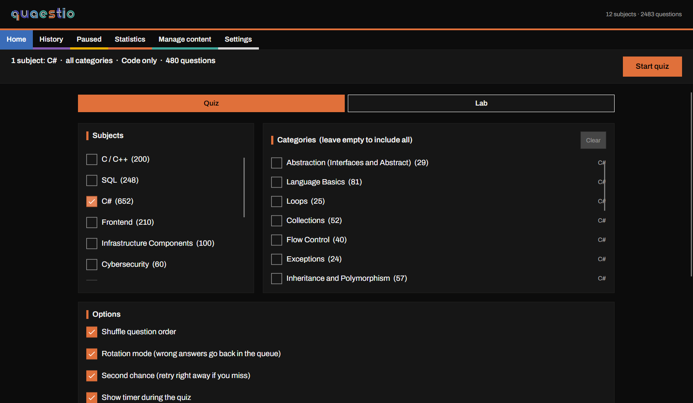
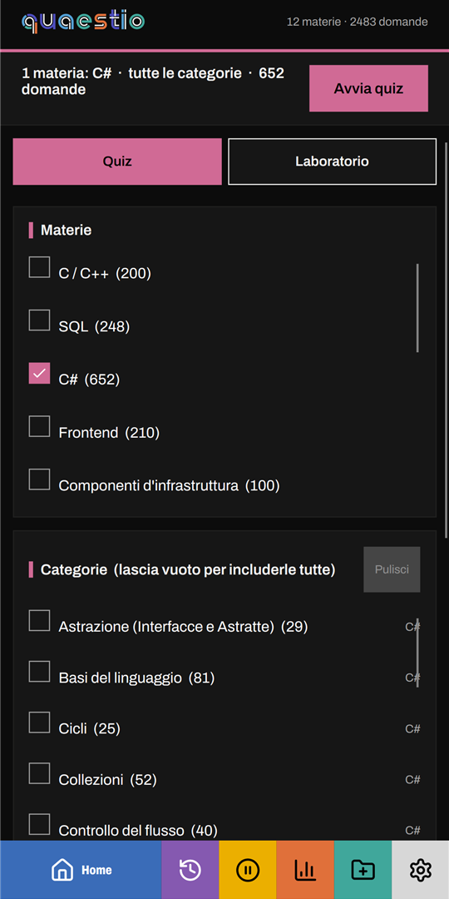
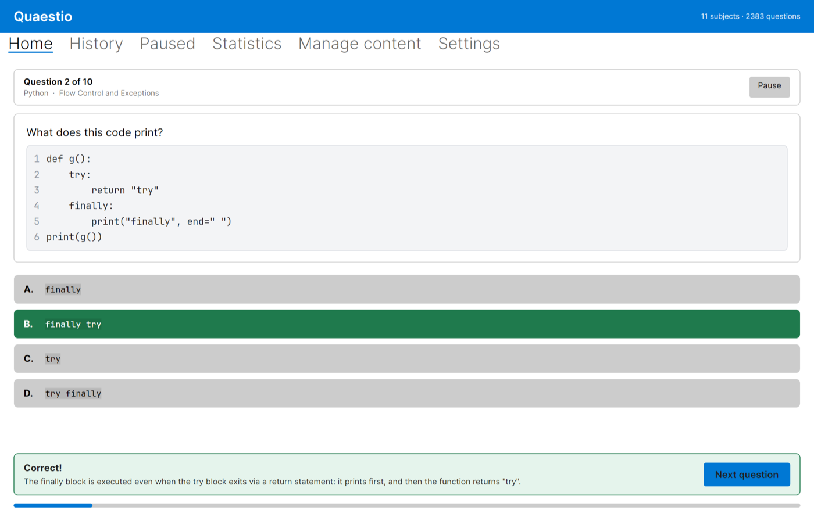
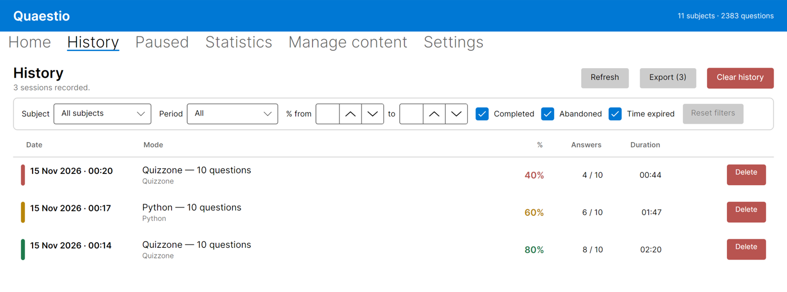
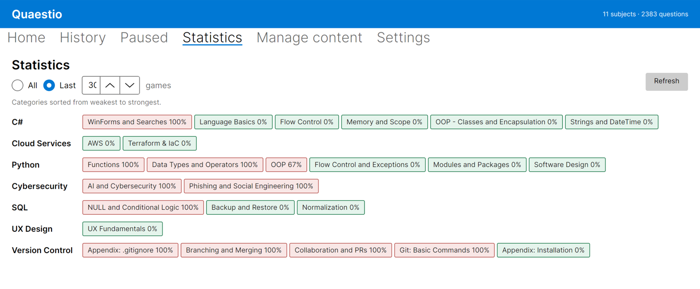
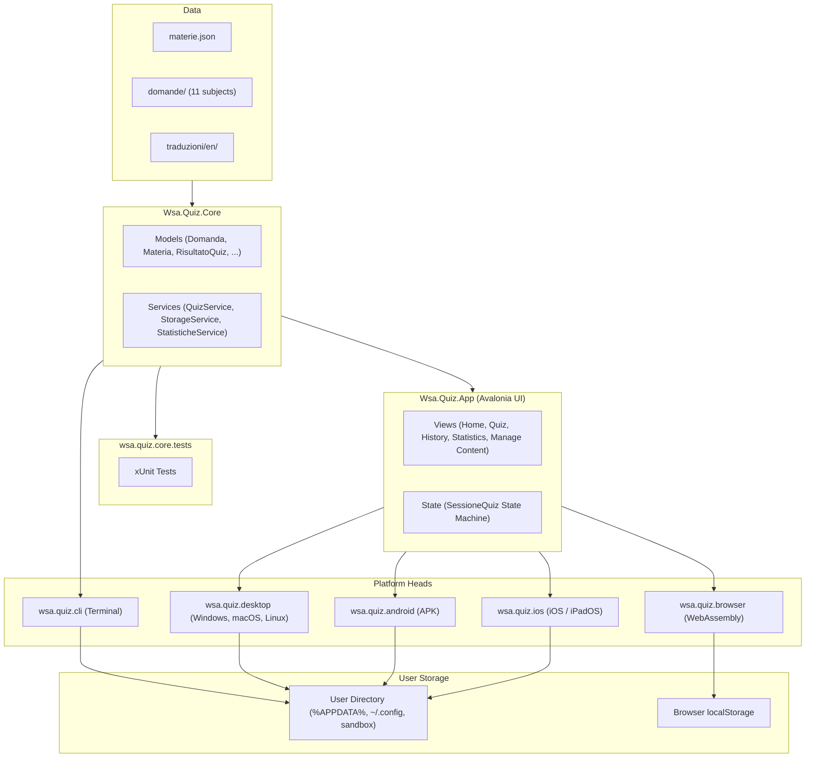

# Quaestio

A multi-subject quiz application built with C# / .NET 10 and Avalonia UI for studying and self-assessment, running on desktop (Windows, macOS, Linux), mobile (Android, iOS/iPadOS), and the web (WebAssembly).

- **Try the Web version:** [lufo-336.github.io/quaestio](https://lufo-336.github.io/quaestio/)
- **Download Android APK:** [Latest Release on GitHub](https://github.com/lufo-336/quaestio/releases/latest)

## Screenshots

<table>
  <tr>
    <td width="72%" valign="top">
      
    </td>
    <td width="28%" valign="top">
      
    </td>
  </tr>
</table>

## The Story

Quaestio started as a simple terminal-based quiz tool to help me review coursework for my Web & Software Architect (WsA) program while I was first learning C#. Over time, the project grew: a graphical interface built with Avalonia was added next to the console version (which still exists and shares the same logic and data), and mobile support followed for Android and iOS/iPadOS, alongside an in-browser WebAssembly build.

Today, the repository includes **11 subjects and 2,383 questions**, with both the application interface and the question banks available in Italian and English.

The project was largely **vibe-coded** in collaboration with AI assistants (Claude Code and Google Antigravity). The git commit history genuinely documents the progression, refactorings, mistakes, and lessons learned of an amateur programmer building a cross-platform application from scratch. Note: parts of the history may have been revised, only to remove personal data (local paths, device and signing identifiers) and large build artifacts; the code and the sequence of changes are unchanged.

## Current Goal

Quaestio has evolved beyond its original coursework focus into a general-purpose study and self-assessment tool. Anyone can take quizzes on existing technical subjects or import custom question sets for their own study routines.

## Features

- **Classic and Rotation Modes:** Take a quiz where each question appears once, or play in rotation mode where incorrectly answered questions cycle back into the queue until answered correctly.
- **Flexible Filters:** Filter questions by subject, category, or cross-cutting question type (`codice` for code snippets, `teoria` for theoretical concepts, and `architettura` for architectural patterns).
- **Pause & Resume:** Suspend an ongoing quiz at any point and resume later from where you left off.
- **Detailed History:** Review past sessions with scores, completion times, and a full drill-down showing user answers versus correct answers.
- **Visual Statistics Heatmap:** Color-coded performance breakdown across subjects and categories, highlighting areas that need review.
- **Content Management:** Create custom subjects or add questions to existing ones directly in the app by importing JSON files.
- **Formatted Code Rendering:** Syntax-formatted code blocks with line numbering and monospace typography (`JetBrains Mono NL`), optimized for both large screens and touch displays.
- **Multilingual Support:** Switch between English and Italian for both UI labels and question contents.
- **Customization:** Choose between multiple accent color themes.







## Architecture

Quaestio is organized around a shared core library and platform-specific heads:

- **`Wsa.Quiz.Core`**: Domain models (`Domanda`, `Materia`, `RisultatoQuiz`), state machines, and business services (`QuizService`, `StorageService`, `StatisticheService`).
- **`Wsa.Quiz.App`**: Shared Avalonia UI containing views, user controls (including `TestoConCodice`), and view state. Built using code-behind and `INotifyPropertyChanged`.
- **Platform Heads**:
  - `wsa.quiz.cli`: Terminal / console head.
  - `wsa.quiz.desktop`: Desktop head for Windows, macOS, and Linux.
  - `wsa.quiz.android`: Android head (APK, single-view with touch navigation).
  - `wsa.quiz.ios`: iOS / iPadOS head.
  - `wsa.quiz.browser`: WebAssembly head deployed as a static bundle.
- **Storage Layer**: Persistent data (history, paused sessions, user preferences, custom subjects) is written to the platform user data directory (`%APPDATA%\WsaQuiz`, `~/.config/WsaQuiz`, `~/Library/Application Support/WsaQuiz`, or app sandbox) or browser `localStorage` under WebAssembly.
- **`wsa.quiz.core.tests`**: xUnit tests covering question parsing, integrity, and scoring.



## Question Generation

When generating multiple-choice questions with large language models, two common biases arise:
1. **Length bias:** Correct options tend to be longer and more elaborately phrased than distractors.
2. **Positional bias:** Correct answers often cluster around specific positions (such as the first or last option).

To solve this, the repository includes a prompt guide ([`generazione-domande/GUIDA_GENERAZIONE_DOMANDE.md`](generazione-domande/GUIDA_GENERAZIONE_DOMANDE.md), written in Italian) and a Node.js generation engine ([`generazione-domande/quiz-engine.js`](generazione-domande/quiz-engine.js)).

The engine balances lengths across four balanced buckets (~25% longest, shortest, intermediate, and similar length), randomizes option order, and validates data integrity.

```bash
# Check length distribution and validation without writing
node "generazione-domande/quiz-engine.js" mysubject.data.js out.json

# Generate final JSON file
node "generazione-domande/quiz-engine.js" mysubject.data.js mysubject_domande.json --write

# Audit an existing question bank
node "generazione-domande/quiz-engine.js" --audit mysubject_domande.json
```

Both files can also be downloaded directly from the in-app "Manage content" tab.

## Adding Custom Subjects

You can add subjects in two ways:

1. **In-app via "Manage content":** Import a `.json` file containing questions. The file is validated before import, and contents are saved locally in the user data folder without modifying repository source files.
2. **In repository source:** Add a subject definition to [`materie.json`](materie.json) and place question files inside `domande/<subject>/`.

### Question JSON Format

Field names are in Italian as they reflect the project's internal data model:

```json
{
  "id": 1,
  "categoria": "Language Basics",
  "domanda": "Which keyword is used in C# to declare an immutable variable at compile time?",
  "risposte": [
    "readonly",
    "const",
    "static",
    "fixed"
  ],
  "rispostaCorretta": 1,
  "spiegazione": "The `const` keyword declares a compile-time constant whose value cannot be modified.",
  "tipo": "teoria"
}
```

| Field | Type | Description |
|---|---|---|
| `id` | int / string | Identifier (the app computes a stable SHA-256 hash of the content at load time). |
| `categoria` | string | Free-form category label used for category filters and statistics. |
| `domanda` | string | Question text. Supports inline `code` and fenced code blocks (```` ```python ````). The same applies to answers and explanations. |
| `risposte` | string[] | Array of answer options (typically 4 choices). Shuffled per game. |
| `rispostaCorretta` | int | Zero-based index (0–3) of the correct answer within `risposte`. |
| `spiegazione` | string | Explanation displayed after the question is answered. |
| `tipo` | string | Question type: `"codice"`, `"teoria"`, or `"architettura"`. |

## Build

### Prerequisites

- [.NET 10 SDK](https://dotnet.microsoft.com/)
- Optional platform workloads (the browser, Android, and iOS heads are kept outside `Wsa.Quiz.sln` so the core solution builds without extra SDKs):
  - Android: `dotnet workload install android` plus JDK 17 and Android SDK
  - iOS: macOS with Xcode, plus `dotnet workload install ios`
  - WebAssembly: `dotnet workload install wasm-tools`

### Building and Running

```bash
# Build main solution (Core, Shared App UI, CLI, Desktop, Tests)
dotnet build Wsa.Quiz.sln

# Run Console head
dotnet run --project wsa.quiz.cli

# Run Desktop GUI head
dotnet run --project wsa.quiz.desktop
```

### Desktop Publishing (Standalone Single File)

```powershell
# Windows x64
dotnet publish wsa.quiz.desktop -c Release -r win-x64 --self-contained `
  -p:PublishSingleFile=true -p:IncludeNativeLibrariesForSelfExtract=true -p:DebugType=none

# macOS Apple Silicon
dotnet publish wsa.quiz.desktop -c Release -r osx-arm64 --self-contained `
  -p:PublishSingleFile=true -p:IncludeNativeLibrariesForSelfExtract=true -p:DebugType=none

# Linux x64
dotnet publish wsa.quiz.desktop -c Release -r linux-x64 --self-contained `
  -p:PublishSingleFile=true -p:IncludeNativeLibrariesForSelfExtract=true -p:DebugType=none
```

### Mobile & Web Heads

```bash
# Android APK (Release signed package)
dotnet build wsa.quiz.android -c Release

# iOS Simulator (macOS + Xcode)
dotnet build wsa.quiz.ios -r iossimulator-arm64 -p:ValidateXcodeVersion=false

# WebAssembly - local dev server
dotnet run --project wsa.quiz.browser

# WebAssembly - publish static bundle (GitHub Pages / Cloudflare Pages)
dotnet publish wsa.quiz.browser -c Release
```

## Note on Naming

The application is branded as **Quaestio** (from the Latin for inquiry or examination). Internal namespaces (`Wsa.Quiz.*`), project names (`wsa.quiz.*`), package identifiers (`it.eduits.wsaquiz`), and the user data folder (`WsaQuiz`) retain the original naming scheme. Renaming internal identifiers would risk breaking saved user history, application preferences, and build configurations; they remain as part of the project's history.

## About the Questions

The built-in questions were generated with AI from course study material. I have not always verified that every question, answer, and explanation is actually correct, so treat them as a study aid, not as a reference: some may contain mistakes.

## Translations

All 11 built-in subjects and 2,383 questions are available in both Italian and English. English translations were produced with AI assistance and are structured as lightweight overlay files located under `traduzioni/en/`.

## Future Goals

- **Question Type Metadata**: Update `GUIDA_GENERAZIONE_DOMANDE.md` and `quiz-engine.js` so newly generated questions automatically include the `tipo` attribute.
- **Language Learning**: Expand question formats to support vocabulary acquisition and foreign language grammar drills.
- **Retry Mode**: Add a training option that allows players to retry a question immediately after a mistake.
- **Study Guides**: Provide introductory theory summaries or companion reference notes alongside pre-installed question banks.

## Acknowledgments

Thanks to my classmates from the Web & Software Architect course for testing the app.

## License

This project is licensed under the MIT License. See [LICENSE](LICENSE) for details.

## How It Was Built & AI Working Notes

Quaestio was developed collaboratively with AI coding agents (Claude Code and Google Antigravity).

Rather than concealing the iterative process, all internal context and planning files are intentionally kept public in this repository:

- [`CLAUDE.md`](CLAUDE.md) provides the primary operational context, coding rules, and conventions used by Claude Code.
- [`docs/README.md`](docs/README.md) documents the contents of the `docs/` folder.
- [`docs/claude/trappole.md`](docs/claude/trappole.md) compiles lessons learned and pitfalls encountered throughout development (spanning Avalonia bindings, Android safe-area insets, linker behavior, and WebAssembly serialization).
- Additional documents in `docs/claude/` cover platform setup, distribution, and architectural decisions.
- `docs/superpowers/` preserves the design specifications (`specs/`) and implementation plans (`plans/`) created prior to major milestones.

With the exception of `docs/README.md`, internal working notes are written in Italian, reflecting the language in which development took place.
